<!-- HERO:START -->
<!-- Wygenerowane przez tools/docs/build_readme.py -->
<div align="center">

# HCB Tools dla Revit

**Natywna wtyczka C# dla Autodesk Revit, stworzona dla projektantów instalacji HVAC i MEP.**<br>
Numeracja, filtry, parametry, przestrzenie, edycja tras i operacje wsadowe na plikach, zebrane na jednej karcie wstążki.

     

<a href="#narzedzia"><b>Narzędzia</b></a> &nbsp;·&nbsp; <a href="#instalacja"><b>Instalacja</b></a> &nbsp;·&nbsp; <a href="#dla-deweloperow"><b>Dla deweloperów</b></a> &nbsp;·&nbsp; <a href="#dokumentacja"><b>Dokumentacja</b></a>

<br>

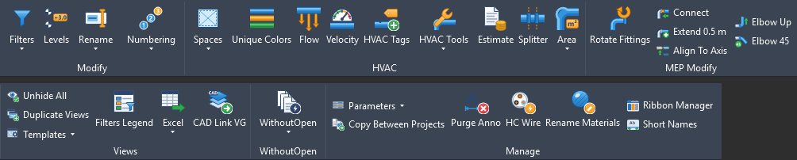

<br>

<a href="#copy-filters" title="Copy Filters"></a> <a href="#bulk-edit" title="Bulk Edit"></a> <a href="#levels" title="Levels">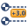</a> <a href="#rename-views" title="Rename Views"></a> <a href="#rename-sheets" title="Rename Sheets"></a> <a href="#manual-num" title="Manual Num"></a> <a href="#ductandfit-num" title="Duct&Fit Num"></a> <a href="#duct-num" title="Duct Num"></a> <a href="#ductfit-num" title="DuctFit Num"></a> <a href="#duct-acc-num" title="Duct Acc Num"></a> <a href="#space-params" title="Space Params"></a> <a href="#space-to-element" title="Space To Element"></a> <a href="#space-cleanup" title="Space Cleanup"></a> <a href="#unique-colors" title="Unique Colors"></a> <a href="#flow" title="Flow">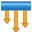</a> <a href="#velocity" title="Velocity"></a> <a href="#hvac-tags" title="HVAC Tags"></a> <a href="#fittings-angle" title="Fittings Angle"></a> <a href="#level-from-hvac" title="Level From HVAC"></a> <a href="#system-assigner" title="System Assigner"></a> <a href="#mass" title="Mass"></a> <a href="#estimate" title="Estimate"></a> <a href="#splitter" title="Splitter"></a> <a href="#area-lin" title="Area LIN"></a> <a href="#area-mc" title="Area MC"></a> <a href="#rotate-fittings" title="Rotate Fittings"></a> <a href="#connect" title="Connect"></a> <a href="#extend-0-5-m" title="Extend 0.5 m"></a> <a href="#align-to-axis" title="Align To Axis"></a> <a href="#elbow-up" title="Elbow Up"></a> <a href="#elbow-45" title="Elbow 45"></a> <a href="#unhide-all" title="Unhide All"></a> <a href="#duplicate-views" title="Duplicate Views"></a> <a href="#view-templates" title="View Templates"></a> <a href="#schedule-templates" title="Schedule Templates"></a> <a href="#filters-legend" title="Filters Legend"></a> <a href="#cad-link-vg" title="CAD Link VG"></a> <a href="#scan-files" title="Scan Files"></a> <a href="#unload-links" title="Unload Links"></a> <a href="#family-report" title="Family Report"></a> <a href="#viewer-export" title="Viewer Export"></a> <a href="#upgrade-copy" title="Upgrade Copy"></a> <a href="#add-shared" title="Add Shared"></a> <a href="#rename-family-params" title="Rename Family Params">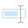</a> <a href="#shared-params" title="Shared Params"></a> <a href="#param-audit" title="Param Audit"></a> <a href="#param-service" title="Param Service"></a> <a href="#calculator" title="Calculator"></a> <a href="#clear-param" title="Clear Param"></a> <a href="#copy-param" title="Copy Param"></a> <a href="#copy-between-projects" title="Copy Between Projects"></a> <a href="#purge-anno" title="Purge Anno"></a> <a href="#hc-wire" title="HC Wire"></a> <a href="#rename-materials" title="Rename Materials"></a> <a href="#ribbon-manager" title="Ribbon Manager"></a> <a href="#short-names" title="Short Names"></a>

<sub>Kliknij ikonę, aby przejść do opisu narzędzia.</sub>

</div>
<!-- HERO:END -->

<br>

## ✨ Najważniejsze

<table>
<tr>
<td width="33%" valign="top">

### 🔢 Numeracja MEP
Kanały, kształtki i akcesoria numerowane według wymiarów i systemu. Identyczne elementy dostają wspólny numer.

</td>
<td width="33%" valign="top">

### 🔧 Szybka edycja tras
Obracanie kształtek, łączenie, przedłużanie o 0,5 m, kolana jednym kliknięciem i wyrównanie do osi bez rozłączania.

</td>
<td width="33%" valign="top">

### 🌬️ Obliczenia HVAC
Dobór średnic do przepływu, masa, powierzchnia kształtek, kosztorys z cennika i dzielenie na odcinki produkcyjne.

</td>
</tr>
<tr>
<td valign="top">

### 📦 Bez otwierania plików
Skan, upgrade, odłączanie linków, raporty i parametry rodzin. Wiele plików .rvt / .rfa naraz, w tle.

</td>
<td valign="top">

### ⚙️ Parametry
Wczytywanie `HC_*`, audyt, kalkulator, kopiowanie i czyszczenie wartości w zaznaczeniu albo w całym modelu.

</td>
<td valign="top">

### 🧩 Porządek na wstążce
Ribbon Manager ukrywa, łączy i przenosi karty oraz panele, także innych wtyczek. Short Names skraca nazwy.

</td>
</tr>
</table>

<br>

<a id="instalacja"></a>

## 📥 Instalacja

1. Pobierz instalator MSI dla swojej wersji Revita, np. `HCB_Tools_1.0.3_R25.msi` (udostępniany w zespole, pliki MSI nie są w repozytorium).
2. Zamknij Revit i uruchom instalator. Instalacja jest per-user i nie wymaga uprawnień administratora.
3. Uruchom Revit. Na wstążce pojawi się karta **HCB Tools**.

| | Revit 2025 | Revit 2026 | Revit 2027 |
| --- | :---: | :---: | :---: |
| Instalator | `…_R25.msi` | `…_R26.msi` | `…_R27.msi` |
| Środowisko | .NET 8 (w Revicie) | .NET 8 (w Revicie) | .NET 10 (w Revicie) |

> [!NOTE]
> Każda wersja Revita ma osobny instalator i można je instalować obok siebie. Nowsza wersja MSI zastępuje starszą.
> Odinstalujesz wtyczkę w *Ustawienia › Aplikacje* (pozycja *HCB Revit Addin &lt;rok&gt;*).

> [!WARNING]
> Jeśli kiedyś była zainstalowana stara wtyczka `HCB.Addin`, usuń raz ręcznie `%AppData%\Autodesk\Revit\Addins\<rok>\HCB.Addin.addin` i folder `HCB.Addin`. Inaczej Revit wczyta obie.

<br>

<!-- TOOLS:START -->
<!-- Wygenerowane przez tools/docs/build_readme.py – nie edytuj ręcznie, zmień tool_texts.py -->

<a id="narzedzia"></a>

## 🧰 Narzędzia

Wtyczka dodaje kartę **HCB Tools** z **6 panelami** i **56 narzędziami**. Na każdym zrzucie **czerwona ramka** pokazuje, gdzie na wstążce znajduje się opisywane narzędzie.

<table>
<tr>
<td align="center" valign="top"><a href="#panel-modify"><b>✏️<br>Modify</b></a><br><sub>10 narzędzi</sub></td>
<td align="center" valign="top"><a href="#panel-hvac"><b>🌬️<br>HVAC</b></a><br><sub>15 narzędzi</sub></td>
<td align="center" valign="top"><a href="#panel-mep-modify"><b>🔧<br>MEP Modify</b></a><br><sub>6 narzędzi</sub></td>
<td align="center" valign="top"><a href="#panel-views"><b>🖼️<br>Views</b></a><br><sub>6 narzędzi</sub></td>
<td align="center" valign="top"><a href="#panel-withoutopen"><b>📦<br>WithoutOpen</b></a><br><sub>7 narzędzi</sub></td>
<td align="center" valign="top"><a href="#panel-manage"><b>⚙️<br>Manage</b></a><br><sub>12 narzędzi</sub></td>
</tr>
</table>

> [!TIP]
> Najedź kursorem na przycisk w Revicie. Podpowiedź pokazuje ten sam opis w skrócie, a po chwili pełną instrukcję.

<br>

<a id="panel-modify"></a>

## ✏️ Panel Modify


> Filtry widoków, poziomy, seryjna zmiana nazw i numeracja elementów.

<p align="center">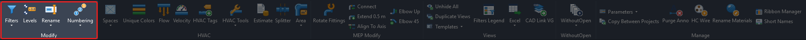</p>

<table>
<tr><th></th><th align="left">Narzędzie</th><th align="left">W skrócie</th></tr>
<tr><td></td><td colspan="2"><b>▾ Filters</b> <sub>– Lista rozwijana z narzędziami do filtrów widoków i szablonów.</sub></td></tr>
<tr><td></td><td>&nbsp;&nbsp;&nbsp;&nbsp;<a href="#copy-filters">Copy Filters</a></td><td>Kopiuje wybrane filtry z jednego widoku lub szablonu widoku do wielu innych widoków i szablonów, razem z ich nadpisaniami grafiki.</td></tr>
<tr><td></td><td>&nbsp;&nbsp;&nbsp;&nbsp;<a href="#bulk-edit">Bulk Edit</a></td><td>Masowo zmienia stan wspólnych filtrów na wielu widokach naraz: włącza, wyłącza albo ukrywa.</td></tr>
<tr><td></td><td><a href="#levels">Levels</a></td><td>Dopisuje do nazw poziomów ich rzędną w metrach w nawiasie, np. <code>Poziom 1 (+3.20)</code>, i aktualizuje już istniejące oznaczenia.</td></tr>
<tr><td></td><td colspan="2"><b>▾ Rename</b> <sub>– Lista rozwijana z narzędziami do seryjnej zmiany nazw widoków i arkuszy.</sub></td></tr>
<tr><td></td><td>&nbsp;&nbsp;&nbsp;&nbsp;<a href="#rename-views">Rename Views</a></td><td>Seryjnie zmienia nazwy wybranych widoków: prefiks, zamiana tekstu i sufiks, z podglądem przed zapisem.</td></tr>
<tr><td></td><td>&nbsp;&nbsp;&nbsp;&nbsp;<a href="#rename-sheets">Rename Sheets</a></td><td>Seryjnie zmienia nazwy i numery arkuszy, z osobnymi regułami dla numeru i dla nazwy.</td></tr>
<tr><td></td><td colspan="2"><b>▾ Numbering</b> <sub>– Lista rozwijana z narzędziami do numeracji. Z zaznaczeniem pracują tylko na nim, bez zaznaczenia zbierają elementy z modelu.</sub></td></tr>
<tr><td></td><td>&nbsp;&nbsp;&nbsp;&nbsp;<a href="#manual-num">Manual Num</a></td><td>Numeruje elementy ręcznie, w kolejności, w jakiej je klikasz.</td></tr>
<tr><td></td><td>&nbsp;&nbsp;&nbsp;&nbsp;<a href="#ductandfit-num">Duct&Fit Num</a></td><td>Numeruje kanały i kształtki kanałowe według kluczy grupujących i System Abbreviation.</td></tr>
<tr><td></td><td>&nbsp;&nbsp;&nbsp;&nbsp;<a href="#duct-num">Duct Num</a></td><td>Numeruje tylko kanały (ducts) według kluczy grupujących i System Abbreviation.</td></tr>
<tr><td></td><td>&nbsp;&nbsp;&nbsp;&nbsp;<a href="#ductfit-num">DuctFit Num</a></td><td>Numeruje tylko kształtki kanałowe.</td></tr>
<tr><td></td><td>&nbsp;&nbsp;&nbsp;&nbsp;<a href="#duct-acc-num">Duct Acc Num</a></td><td>Numeruje Duct Accessory w formacie <code>TypeMark.HC_System.KolejnyNumer</code>.</td></tr>
</table>

<br>

<a id="copy-filters"></a>

###  Copy Filters

  

<table>
<tr>
<td width="440" align="center" valign="top">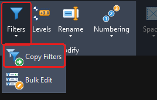</td>
<td valign="top">

**Co robi**<br>Kopiuje wybrane filtry z jednego widoku lub szablonu widoku do wielu innych widoków i szablonów, razem z ich nadpisaniami grafiki.

**Jak użyć**

1. Wskaż widok lub szablon źródłowy.
2. Zaznacz filtry i widoki docelowe.
3. Potwierdź kopiowanie i rozstrzygnij konflikty.

**Zakres**<br>Widoki i view templates w bieżącym projekcie.

</td>
</tr>
</table>

<p align="right"><sub><a href="#narzedzia">↑ do spisu narzędzi</a></sub></p>

<br>

<a id="bulk-edit"></a>

###  Bulk Edit

 

<table>
<tr>
<td width="440" align="center" valign="top">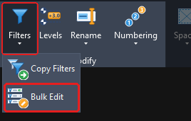</td>
<td valign="top">

**Co robi**<br>Masowo zmienia stan wspólnych filtrów na wielu widokach naraz: włącza, wyłącza albo ukrywa.

**Jak użyć**

1. Wybierz widoki.
2. Zaznacz filtry wspólne dla wybranych widoków.
3. Ustaw akcję (ON, OFF, ukrycie) i zatwierdź.

**Zakres**<br>Wiele widoków i szablonów jednocześnie.

</td>
</tr>
</table>

<p align="right"><sub><a href="#narzedzia">↑ do spisu narzędzi</a></sub></p>

<br>

<a id="levels"></a>

###  Levels

  

<table>
<tr>
<td width="440" align="center" valign="top">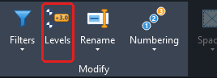</td>
<td valign="top">

**Co robi**<br>Dopisuje do nazw poziomów ich rzędną w metrach w nawiasie, np. `Poziom 1 (+3.20)`, i aktualizuje już istniejące oznaczenia.

**Jak użyć**

1. Uruchom polecenie w projekcie z poziomami.
2. Ustaw liczbę miejsc po przecinku i znak `+` dla wartości dodatnich, sprawdź podgląd.
3. Kliknij *Aktualizuj poziomy*.

**Zakres**<br>Wszystkie poziomy w projekcie.

</td>
</tr>
</table>

> [!TIP]
> Po zmianie wysokości poziomu uruchom narzędzie ponownie, aby odświeżyć rzędne w nazwach.

<p align="right"><sub><a href="#narzedzia">↑ do spisu narzędzi</a></sub></p>

<br>

<a id="rename-views"></a>

###  Rename Views

 

<table>
<tr>
<td width="440" align="center" valign="top">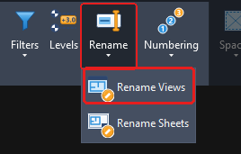</td>
<td valign="top">

**Co robi**<br>Seryjnie zmienia nazwy wybranych widoków: prefiks, zamiana tekstu i sufiks, z podglądem przed zapisem.

**Jak użyć**

1. Wybierz widoki.
2. Ustaw prefiks, zamianę tekstu i/lub sufiks.
3. Sprawdź podgląd i zatwierdź.

**Zakres**<br>Tylko wybrane widoki.

</td>
</tr>
</table>

<p align="right"><sub><a href="#narzedzia">↑ do spisu narzędzi</a></sub></p>

<br>

<a id="rename-sheets"></a>

###  Rename Sheets

 

<table>
<tr>
<td width="440" align="center" valign="top">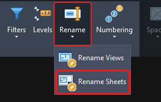</td>
<td valign="top">

**Co robi**<br>Seryjnie zmienia nazwy i numery arkuszy, z osobnymi regułami dla numeru i dla nazwy.

**Jak użyć**

1. Wybierz arkusze.
2. Ustaw zasady osobno dla numeru i nazwy.
3. Sprawdź podgląd i zatwierdź.

**Zakres**<br>Tylko wybrane arkusze.

</td>
</tr>
</table>

<p align="right"><sub><a href="#narzedzia">↑ do spisu narzędzi</a></sub></p>

<br>

<a id="manual-num"></a>

###  Manual Num

 

<table>
<tr>
<td width="440" align="center" valign="top">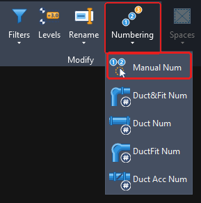</td>
<td valign="top">

**Co robi**<br>Numeruje elementy ręcznie, w kolejności, w jakiej je klikasz. Daje pełną kontrolę nad kolejnością numerów.

**Jak użyć**

1. Zaznacz elementy.
2. Wybierz parametr docelowy i format numeru.
3. Klikaj elementy w zadanej kolejności.

**Zakres**<br>Wskazane elementy.

</td>
</tr>
</table>

<p align="right"><sub><a href="#narzedzia">↑ do spisu narzędzi</a></sub></p>

<br>

<a id="ductandfit-num"></a>

###  Duct&Fit Num

   

<table>
<tr>
<td width="440" align="center" valign="top">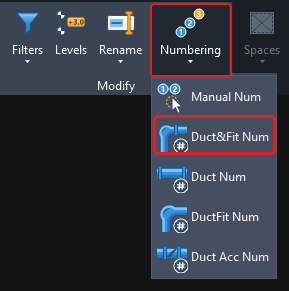</td>
<td valign="top">

**Co robi**<br>Numeruje kanały i kształtki kanałowe według kluczy grupujących i System Abbreviation. Identyczne elementy dostają wspólny numer.

**Jak użyć**

1. Wybierz parametr docelowy.
2. Ustaw numer startowy i opcjonalnie parametr długości.
3. Zatwierdź numerację.

**Zakres**<br>Zaznaczone ducts i fittings, a bez zaznaczenia wszystkie z modelu.

</td>
</tr>
</table>

> [!NOTE]
> Grupy z różnymi System Abbreviation dostają numer bez prefiksu systemu.

<p align="right"><sub><a href="#narzedzia">↑ do spisu narzędzi</a></sub></p>

<br>

<a id="duct-num"></a>

###  Duct Num

  

<table>
<tr>
<td width="440" align="center" valign="top">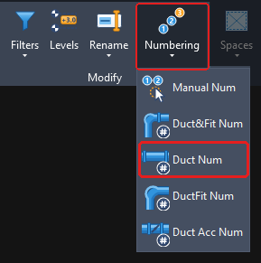</td>
<td valign="top">

**Co robi**<br>Numeruje tylko kanały (ducts) według kluczy grupujących i System Abbreviation.

**Jak użyć**

1. Wybierz parametr docelowy.
2. Ustaw numer startowy i sposób grupowania.
3. Zatwierdź numerację.

**Zakres**<br>Zaznaczone ducts, a bez zaznaczenia wszystkie obsługiwane ducts z projektu.

</td>
</tr>
</table>

> [!NOTE]
> Grupy z różnymi System Abbreviation dostają numer bez prefiksu systemu.

<p align="right"><sub><a href="#narzedzia">↑ do spisu narzędzi</a></sub></p>

<br>

<a id="ductfit-num"></a>

###  DuctFit Num

  

<table>
<tr>
<td width="440" align="center" valign="top">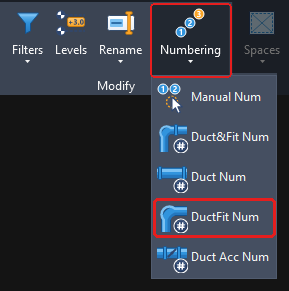</td>
<td valign="top">

**Co robi**<br>Numeruje tylko kształtki kanałowe. Grupuje je po wymiarach LIN_VE, kącie i System Abbreviation.

**Jak użyć**

1. Wybierz parametr docelowy.
2. Ustaw numer startowy.
3. Zatwierdź numerację.

**Zakres**<br>Zaznaczone duct fittings, a bez zaznaczenia wszystkie obsługiwane kształtki z projektu.

</td>
</tr>
</table>

> [!NOTE]
> Grupy mieszane systemowo dostają numer bez prefiksu systemu.

<p align="right"><sub><a href="#narzedzia">↑ do spisu narzędzi</a></sub></p>

<br>

<a id="duct-acc-num"></a>

###  Duct Acc Num

  

<table>
<tr>
<td width="440" align="center" valign="top">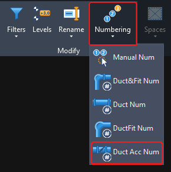</td>
<td valign="top">

**Co robi**<br>Numeruje Duct Accessory w formacie `TypeMark.HC_System.KolejnyNumer`. Elementy o tym samym układzie w obrębie jednego HC_System dostają wspólny numer.

**Jak użyć**

1. Wybierz parametr docelowy.
2. Ustaw numer startowy albo kontynuuj od ostatniego numeru w projekcie.
3. Zatwierdź numerację.

**Zakres**<br>Zaznaczone Duct Accessory, a bez zaznaczenia wszystkie z projektu.

</td>
</tr>
</table>

> [!NOTE]
> Typy FabricAir są pomijane.

<p align="right"><sub><a href="#narzedzia">↑ do spisu narzędzi</a></sub></p>

<br>

<br>

---

<br>

<a id="panel-hvac"></a>

## 🌬️ Panel HVAC


> Narzędzia instalacyjne: przestrzenie, przepływy, dobór średnic, tagowanie, masy, powierzchnie i kosztorys.

<p align="center">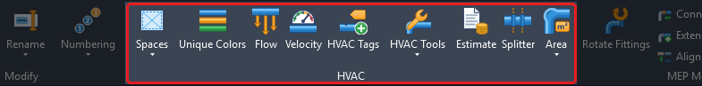</p>

<table>
<tr><th></th><th align="left">Narzędzie</th><th align="left">W skrócie</th></tr>
<tr><td></td><td colspan="2"><b>▾ Spaces</b> <sub>– Lista rozwijana z narzędziami do przestrzeni MEP i parametrów LIN_ROOM_*.</sub></td></tr>
<tr><td></td><td>&nbsp;&nbsp;&nbsp;&nbsp;<a href="#space-params">Space Params</a></td><td>Uzupełnia parametry <code>LIN_ROOM_*</code> elementów na podstawie pomieszczeń (rooms) z podlinkowanego modelu architektury.</td></tr>
<tr><td></td><td>&nbsp;&nbsp;&nbsp;&nbsp;<a href="#space-to-element">Space To Element</a></td><td>Uzupełnia parametry <code>LIN_ROOM_*</code> na podstawie lokalnych przestrzeni MEP (spaces) w modelu.</td></tr>
<tr><td></td><td>&nbsp;&nbsp;&nbsp;&nbsp;<a href="#space-cleanup">Space Cleanup</a></td><td>Pokazuje listę wszystkich przestrzeni MEP z nazwą, numerem, poziomem i statusem.</td></tr>
<tr><td></td><td><a href="#unique-colors">Unique Colors</a></td><td>Nadaje kolory wybranym systemom wentylacyjnym i rurowym jako nadpisania grafiki, według konfiguracji z pliku CSV.</td></tr>
<tr><td></td><td><a href="#flow">Flow</a></td><td>Losowo różnicuje przepływy na terminalach w aktywnym widoku.</td></tr>
<tr><td></td><td><a href="#velocity">Velocity</a></td><td>Dobiera średnice okrągłych kanałów i rur do przepływu.</td></tr>
<tr><td></td><td><a href="#hvac-tags">HVAC Tags</a></td><td>Wyszukuje brakujące tagi elementów HVAC i tworzy je po zatwierdzeniu.</td></tr>
<tr><td></td><td colspan="2"><b>▾ HVAC Tools</b> <sub>– Lista rozwijana z pomocniczymi narzędziami HVAC: kąty, poziomy, systemy i masa.</sub></td></tr>
<tr><td></td><td>&nbsp;&nbsp;&nbsp;&nbsp;<a href="#fittings-angle">Fittings Angle</a></td><td>Kopiuje kąty kształtek do parametru <code>HC_Kat</code> i je zaokrągla.</td></tr>
<tr><td></td><td>&nbsp;&nbsp;&nbsp;&nbsp;<a href="#level-from-hvac">Level From HVAC</a></td><td>Kopiuje Level albo Reference Level elementu do wybranego parametru instancji.</td></tr>
<tr><td></td><td>&nbsp;&nbsp;&nbsp;&nbsp;<a href="#system-assigner">System Assigner</a></td><td>Przenosi wartość parametru (np. <code>HC_System</code>) z urządzenia na wszystkie elementy przypisanych do niego systemów.</td></tr>
<tr><td></td><td>&nbsp;&nbsp;&nbsp;&nbsp;<a href="#mass">Mass</a></td><td>Oblicza masę (<code>HC_Masa</code>) kanałów, kształtek i akcesoriów wentylacyjnych.</td></tr>
<tr><td></td><td><a href="#estimate">Estimate</a></td><td>Wylicza ceny jednostkowe i koszty elementów wentylacji według pliku cennika.</td></tr>
<tr><td></td><td><a href="#splitter">Splitter</a></td><td>Dzieli proste kanały i rury na odcinki produkcyjne o zadanej długości i wstawia między nimi łączniki.</td></tr>
<tr><td></td><td colspan="2"><b>▾ Area</b> <sub>– Lista rozwijana z obliczaniem powierzchni kształtek (HC_Area) dla rodzin LINEAR i MagiCAD.</sub></td></tr>
<tr><td></td><td>&nbsp;&nbsp;&nbsp;&nbsp;<a href="#area-lin">Area LIN</a></td><td>Oblicza powierzchnię kształtek wentylacyjnych z rodzin LINEAR i zapisuje ją do <code>HC_Area</code>.</td></tr>
<tr><td></td><td>&nbsp;&nbsp;&nbsp;&nbsp;<a href="#area-mc">Area MC</a></td><td>Oblicza powierzchnię kształtek wentylacyjnych z rodzin MagiCAD i zapisuje ją do <code>HC_Area</code>.</td></tr>
</table>

<br>

<a id="space-params"></a>

###  Space Params

  

<table>
<tr>
<td width="440" align="center" valign="top">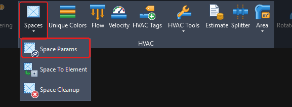</td>
<td valign="top">

**Co robi**<br>Uzupełnia parametry `LIN_ROOM_*` elementów na podstawie pomieszczeń (rooms) z podlinkowanego modelu architektury.

**Jak użyć**

1. Uruchom narzędzie w projekcie z linkiem architektury.
2. Wskaż lub potwierdź link.
3. Zapisz wynik.

**Zakres**<br>Głównie Mechanical Equipment.

</td>
</tr>
</table>

<p align="right"><sub><a href="#narzedzia">↑ do spisu narzędzi</a></sub></p>

<br>

<a id="space-to-element"></a>

###  Space To Element

  

<table>
<tr>
<td width="440" align="center" valign="top">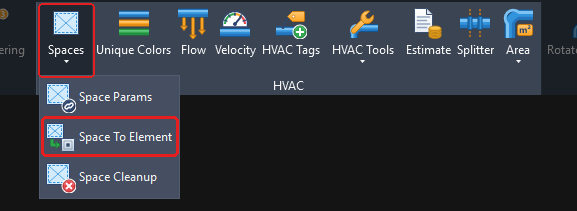</td>
<td valign="top">

**Co robi**<br>Uzupełnia parametry `LIN_ROOM_*` na podstawie lokalnych przestrzeni MEP (spaces) w modelu.

**Jak użyć**

1. Otwórz odpowiedni widok.
2. Uruchom narzędzie.
3. Zapisz wynik.

**Zakres**<br>Wszystkie spaces w modelu oraz elementy obsługiwanych kategorii.

</td>
</tr>
</table>

> [!NOTE]
> Alternatywa dla Space Params, gdy pracujesz na spaces, a nie na rooms z linku.

<p align="right"><sub><a href="#narzedzia">↑ do spisu narzędzi</a></sub></p>

<br>

<a id="space-cleanup"></a>

###  Space Cleanup

  

<table>
<tr>
<td width="440" align="center" valign="top">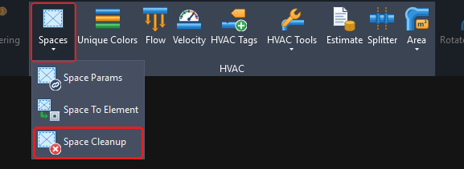</td>
<td valign="top">

**Co robi**<br>Pokazuje listę wszystkich przestrzeni MEP z nazwą, numerem, poziomem i statusem. Usuwa wybrane przestrzenie razem z ich znacznikami.

**Jak użyć**

1. Wpisz frazę z nazwy, np. `Wolny`.
2. Ustaw filtr statusu (nieumieszczona, nieobwiedziona, nadmiarowa) i ewentualnie poziom.
3. Kliknij *Zaznacz wszystkie*, potem *Usuń wybrane* i potwierdź.

**Zakres**<br>Lokalne spaces w modelu.

</td>
</tr>
</table>

> [!TIP]
> Całość wykonuje się w jednej transakcji, więc możesz ją cofnąć przez `Ctrl+Z`.

<p align="right"><sub><a href="#narzedzia">↑ do spisu narzędzi</a></sub></p>

<br>

<a id="unique-colors"></a>

###  Unique Colors

  

<table>
<tr>
<td width="440" align="center" valign="top">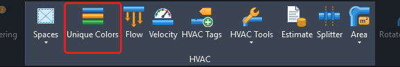</td>
<td valign="top">

**Co robi**<br>Nadaje kolory wybranym systemom wentylacyjnym i rurowym jako nadpisania grafiki, według konfiguracji z pliku CSV.

**Jak użyć**

1. Uruchom narzędzie w aktywnym widoku.
2. Wybierz systemy z listy (plik CSV).
3. Zatwierdź nadpisania.

**Zakres**<br>Tylko aktywny widok.

</td>
</tr>
</table>

<p align="right"><sub><a href="#narzedzia">↑ do spisu narzędzi</a></sub></p>

<br>

<a id="flow"></a>

###  Flow

  

<table>
<tr>
<td width="440" align="center" valign="top">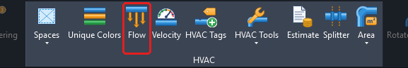</td>
<td valign="top">

**Co robi**<br>Losowo różnicuje przepływy na terminalach w aktywnym widoku. Służy do szybkiego testowania wariantów przepływu.

**Jak użyć**

1. Uruchom narzędzie w aktywnym widoku.
2. Wybierz parametr docelowy i zakres zmiany.
3. Zatwierdź.

**Zakres**<br>Terminale w aktywnym widoku.

</td>
</tr>
</table>

<p align="right"><sub><a href="#narzedzia">↑ do spisu narzędzi</a></sub></p>

<br>

<a id="velocity"></a>

###  Velocity

   

<table>
<tr>
<td width="440" align="center" valign="top">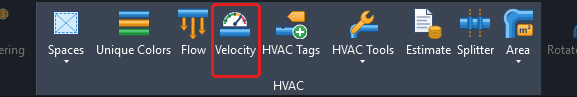</td>
<td valign="top">

**Co robi**<br>Dobiera średnice okrągłych kanałów i rur do przepływu. Pokazuje tabelę standardowych średnic z projektu i prędkości dla każdej z nich.

**Jak użyć**

1. Zaznacz okrągłe kanały lub rury.
2. Wpisz przepływ dla każdego wiersza.
3. Wybierz średnicę z tabeli i zatwierdź.

**Zakres**<br>Zmienia średnicę elementu i zapisuje `LIN_VE_VELOCITY` oraz `LIN_VE_FLOWRATE_SUM`.

</td>
</tr>
</table>

> [!NOTE]
> Gdy parametry mają już wartości, narzędzie pyta o nadpisanie.

<p align="right"><sub><a href="#narzedzia">↑ do spisu narzędzi</a></sub></p>

<br>

<a id="hvac-tags"></a>

###  HVAC Tags

  

<table>
<tr>
<td width="440" align="center" valign="top">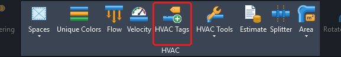</td>
<td valign="top">

**Co robi**<br>Wyszukuje brakujące tagi elementów HVAC i tworzy je po zatwierdzeniu. Wcześniej pokazuje podgląd tagów brakujących, istniejących i zduplikowanych.

**Jak użyć**

1. Otwórz widok albo arkusz.
2. Uruchom narzędzie i przejrzyj podgląd.
3. Zatwierdź tworzenie brakujących tagów.

**Zakres**<br>Aktywny widok albo viewporty aktywnego arkusza. Obejmuje ducts, flex ducts, duct fittings, duct accessories i duct terminals.

</td>
</tr>
</table>

> [!NOTE]
> Używa tylko typów tagów wczytanych już do projektu.

<p align="right"><sub><a href="#narzedzia">↑ do spisu narzędzi</a></sub></p>

<br>

<a id="fittings-angle"></a>

###  Fittings Angle

  

<table>
<tr>
<td width="440" align="center" valign="top">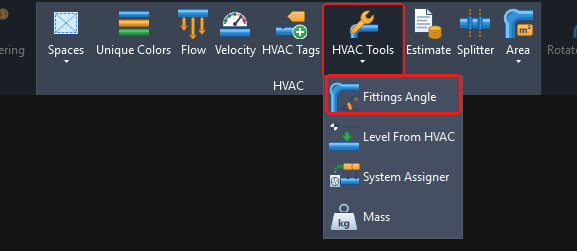</td>
<td valign="top">

**Co robi**<br>Kopiuje kąty kształtek do parametru `HC_Kat` i je zaokrągla.

**Jak użyć**

1. Zaznacz kształtki albo pozwól narzędziu pobrać obsługiwane elementy.
2. Uruchom polecenie.
3. Zapisz wynik.

**Zakres**<br>Prostokątne kształtki kanałowe zaokrągla do 1°, pozostałe do 5°.

</td>
</tr>
</table>

<p align="right"><sub><a href="#narzedzia">↑ do spisu narzędzi</a></sub></p>

<br>

<a id="level-from-hvac"></a>

###  Level From HVAC

 

<table>
<tr>
<td width="440" align="center" valign="top">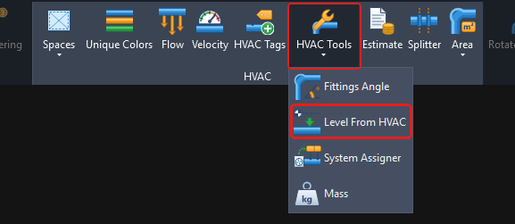</td>
<td valign="top">

**Co robi**<br>Kopiuje Level albo Reference Level elementu do wybranego parametru instancji.

**Jak użyć**

1. Zaznacz elementy HVAC.
2. Wybierz parametr docelowy.
3. Zatwierdź.

**Zakres**<br>Tylko zaznaczenie. Obsługuje parametry typu String i ElementId.

</td>
</tr>
</table>

<p align="right"><sub><a href="#narzedzia">↑ do spisu narzędzi</a></sub></p>

<br>

<a id="system-assigner"></a>

###  System Assigner

  

<table>
<tr>
<td width="440" align="center" valign="top">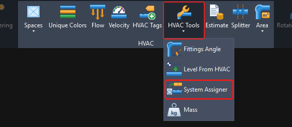</td>
<td valign="top">

**Co robi**<br>Przenosi wartość parametru (np. `HC_System`) z urządzenia na wszystkie elementy przypisanych do niego systemów.

**Jak użyć**

1. Zaznacz Mechanical Equipment.
2. Wybierz parametr do przeniesienia.
3. Zatwierdź.

**Zakres**<br>Poprawnie połączone systemy przypisane do wskazanych urządzeń.

</td>
</tr>
</table>

<p align="right"><sub><a href="#narzedzia">↑ do spisu narzędzi</a></sub></p>

<br>

<a id="mass"></a>

###  Mass

  

<table>
<tr>
<td width="440" align="center" valign="top">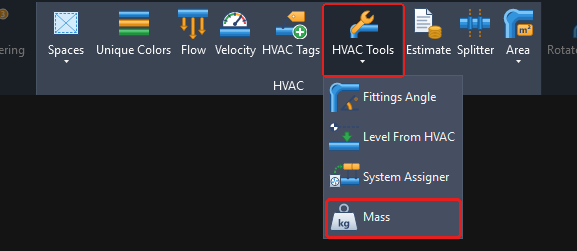</td>
<td valign="top">

**Co robi**<br>Oblicza masę (`HC_Masa`) kanałów, kształtek i akcesoriów wentylacyjnych.

**Jak użyć**

1. Wybierz parametr docelowy, jeśli narzędzie o to poprosi.
2. Uruchom obliczenie.
3. Zapisz wynik.

**Zakres**<br>Zaznaczenie, a bez zaznaczenia obsługiwane elementy wentylacyjne z projektu.

</td>
</tr>
</table>

<p align="right"><sub><a href="#narzedzia">↑ do spisu narzędzi</a></sub></p>

<br>

<a id="estimate"></a>

###  Estimate

  

<table>
<tr>
<td width="440" align="center" valign="top">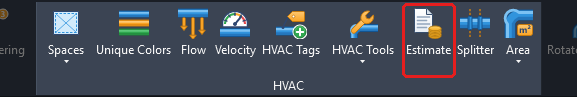</td>
<td valign="top">

**Co robi**<br>Wylicza ceny jednostkowe i koszty elementów wentylacji według pliku cennika.

**Jak użyć**

1. Wskaż plik cennika albo użyj domyślnej konfiguracji.
2. Uruchom przeliczenie.
3. Sprawdź raport dopasowań.

**Zakres**<br>Zapisuje `HC_Cena_Jednostkowa` i `HC_Koszt` dla obsługiwanych elementów wentylacji.

</td>
</tr>
</table>

<p align="right"><sub><a href="#narzedzia">↑ do spisu narzędzi</a></sub></p>

<br>

<a id="splitter"></a>

###  Splitter

   

<table>
<tr>
<td width="440" align="center" valign="top">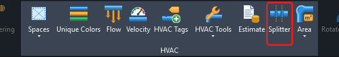</td>
<td valign="top">

**Co robi**<br>Dzieli proste kanały i rury na odcinki produkcyjne o zadanej długości i wstawia między nimi łączniki.

**Jak użyć**

1. Wpisz długość produkcyjną i wybierz ducts, pipes albo oba typy.
2. Klikaj elementy bliżej strony, od której ma zacząć się podział.
3. `ESC` kończy.

**Zakres**<br>Podział zaczyna się od wskazanej strony, reszta zostaje na przeciwnym końcu.

</td>
</tr>
</table>

> [!TIP]
> Kliknięcie już pociętego ciągu przebudowuje go od najbliższego fittingu lub accessory i przelicza rozstaw od nowa.

<p align="right"><sub><a href="#narzedzia">↑ do spisu narzędzi</a></sub></p>

<br>

<a id="area-lin"></a>

###  Area LIN

  

<table>
<tr>
<td width="440" align="center" valign="top">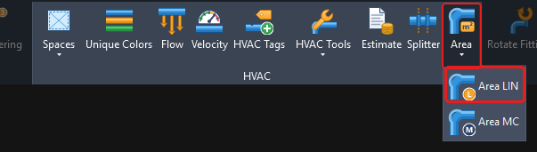</td>
<td valign="top">

**Co robi**<br>Oblicza powierzchnię kształtek wentylacyjnych z rodzin LINEAR i zapisuje ją do `HC_Area`.

**Jak użyć**

1. Uruchom narzędzie dla rodzin przygotowanych pod LINEAR.
2. Wybierz zakres albo ustawienia.
3. Zapisz wynik.

**Zakres**<br>Raport i zapis do `HC_Area`.

</td>
</tr>
</table>

<p align="right"><sub><a href="#narzedzia">↑ do spisu narzędzi</a></sub></p>

<br>

<a id="area-mc"></a>

###  Area MC

  

<table>
<tr>
<td width="440" align="center" valign="top">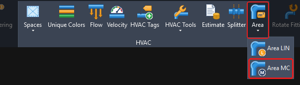</td>
<td valign="top">

**Co robi**<br>Oblicza powierzchnię kształtek wentylacyjnych z rodzin MagiCAD i zapisuje ją do `HC_Area`.

**Jak użyć**

1. Uruchom narzędzie dla rodzin przygotowanych pod MagiCAD.
2. Wybierz zakres albo ustawienia.
3. Zapisz wynik.

**Zakres**<br>Raport i zapis do `HC_Area`.

</td>
</tr>
</table>

<p align="right"><sub><a href="#narzedzia">↑ do spisu narzędzi</a></sub></p>

<br>

<br>

---

<br>

<a id="panel-mep-modify"></a>

## 🔧 Panel MEP Modify


> Szybka edycja tras: obracanie kształtek, łączenie, przedłużanie i wyrównywanie elementów.

<p align="center">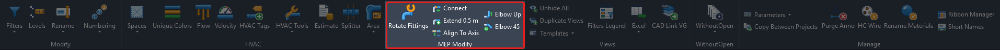</p>

<table>
<tr><th></th><th align="left">Narzędzie</th><th align="left">W skrócie</th></tr>
<tr><td></td><td><a href="#rotate-fittings">Rotate Fittings</a></td><td>Obraca klikane kształtki o wybrany kąt wokół osi podłączonego konektora albo wokół osi pionowej.</td></tr>
<tr><td></td><td><a href="#connect">Connect</a></td><td>Dosuwa i obraca drugi element razem ze wszystkim, co jest do niego podłączone, tak aby jego wolny konektor pokrył się z konektorem pierwszego.</td></tr>
<tr><td></td><td><a href="#extend-0-5-m">Extend 0.5 m</a></td><td>Z klikniętego wolnego konektora wstawia prosty odcinek 500 mm w jego kierunku i rozmiarze, od razu podłączony.</td></tr>
<tr><td></td><td><a href="#align-to-axis">Align To Axis</a></td><td>Przesuwa rurę, kanał albo kształtkę tak, aby jej oś przecięła oś odcinka odniesienia.</td></tr>
<tr><td></td><td><a href="#elbow-up">Elbow Up</a></td><td>Na klikniętym wolnym konektorze wstawia kolano i prosty odcinek 500 mm skierowany w górę (globalna oś Z).</td></tr>
<tr><td></td><td><a href="#elbow-45">Elbow 45</a></td><td>Na klikniętym wolnym konektorze wstawia kolano 45° i odcinek 500 mm odchylony o 45° w prawo (patrząc wzdłuż konektora z góry).</td></tr>
</table>

<br>

<a id="rotate-fittings"></a>

###  Rotate Fittings

  

<table>
<tr>
<td width="440" align="center" valign="top">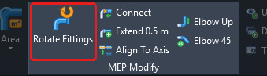</td>
<td valign="top">

**Co robi**<br>Obraca klikane kształtki o wybrany kąt wokół osi podłączonego konektora albo wokół osi pionowej. Okno zostaje otwarte obok Revita.

**Jak użyć**

1. Kliknij kąt (±45°, 90°, 135°, 180°) albo wpisz własny i naciśnij `Enter`.
2. Klikaj kształtki. Każde kliknięcie obraca o zadany kąt.
3. `ESC` wstrzymuje wskazywanie, *Zamknij* kończy pracę.

**Zakres**<br>Duct, Pipe i Conduit Fittings.

</td>
</tr>
</table>

> [!WARNING]
> Połączenia na obracanych końcach są rozłączane.

<p align="right"><sub><a href="#narzedzia">↑ do spisu narzędzi</a></sub></p>

<br>

<a id="connect"></a>

###  Connect

  

<table>
<tr>
<td width="440" align="center" valign="top">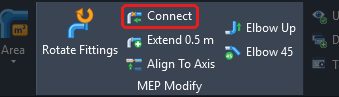</td>
<td valign="top">

**Co robi**<br>Dosuwa i obraca drugi element razem ze wszystkim, co jest do niego podłączone, tak aby jego wolny konektor pokrył się z konektorem pierwszego. Następnie je łączy.

**Jak użyć**

1. Kliknij element, **do którego** łączysz (blisko konektora).
2. Kliknij element, **który** ma zostać dosunięty (blisko wolnego konektora).
3. Powtarzaj pary, `ESC` kończy.

**Zakres**<br>Elementy z konektorami tej samej dziedziny. Rozmiary i typy nie są dopasowywane.

</td>
</tr>
</table>

> [!NOTE]
> Przesuwana grupa może mieć do 500 elementów i nie może być już połączona z elementem docelowym.

<p align="right"><sub><a href="#narzedzia">↑ do spisu narzędzi</a></sub></p>

<br>

<a id="extend-0-5-m"></a>

###  Extend 0.5 m

  

<table>
<tr>
<td width="440" align="center" valign="top">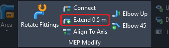</td>
<td valign="top">

**Co robi**<br>Z klikniętego wolnego konektora wstawia prosty odcinek 500 mm w jego kierunku i rozmiarze, od razu podłączony.

**Jak użyć**

1. Klikaj elementy blisko wolnych konektorów (kolano, trójnik, koniec kanału, urządzenie).
2. `ESC` kończy.

**Zakres**<br>Ducts, pipes, conduits. Typ i system pochodzą z sąsiedniego odcinka, a gdy go brak, z pierwszego pasującego typu w projekcie.

</td>
</tr>
</table>

<p align="right"><sub><a href="#narzedzia">↑ do spisu narzędzi</a></sub></p>

<br>

<a id="align-to-axis"></a>

###  Align To Axis

  

<table>
<tr>
<td width="440" align="center" valign="top">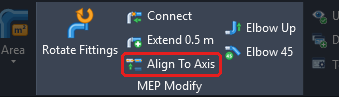</td>
<td valign="top">

**Co robi**<br>Przesuwa rurę, kanał albo kształtkę tak, aby jej oś przecięła oś odcinka odniesienia. Elementy równoległe stają się współliniowe.

**Jak użyć**

1. Kliknij prosty odcinek odniesienia.
2. Klikaj dochodzące elementy, np. prostopadłą rurę.
3. `ESC` kończy.

**Zakres**<br>Ducts, pipes, conduits i elementy z konektorami.

</td>
</tr>
</table>

> [!TIP]
> Przesunięcie odbywa się tylko w poprzek obu osi, więc istniejące połączenia zostają.

<p align="right"><sub><a href="#narzedzia">↑ do spisu narzędzi</a></sub></p>

<br>

<a id="elbow-up"></a>

###  Elbow Up

  

<table>
<tr>
<td width="440" align="center" valign="top">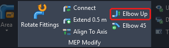</td>
<td valign="top">

**Co robi**<br>Na klikniętym wolnym konektorze wstawia kolano i prosty odcinek 500 mm skierowany w górę (globalna oś Z).

**Jak użyć**

1. Klikaj elementy blisko wolnych konektorów.
2. `ESC` kończy.
3. Kierunek możesz potem zmienić narzędziem Rotate Fittings.

**Zakres**<br>Ducts, pipes, conduits. Kolano pochodzi z routing preferences typu odcinka.

</td>
</tr>
</table>

> [!NOTE]
> Na końcu kanału kolano zajmuje jego końcówkę. Na kształtce siada bezpośrednio na konektorze.

<p align="right"><sub><a href="#narzedzia">↑ do spisu narzędzi</a></sub></p>

<br>

<a id="elbow-45"></a>

###  Elbow 45

  

<table>
<tr>
<td width="440" align="center" valign="top">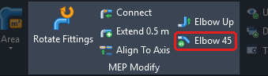</td>
<td valign="top">

**Co robi**<br>Na klikniętym wolnym konektorze wstawia kolano 45° i odcinek 500 mm odchylony o 45° w prawo (patrząc wzdłuż konektora z góry).

**Jak użyć**

1. Klikaj elementy blisko wolnych konektorów.
2. `ESC` kończy.
3. Inny kierunek ustawisz narzędziem Rotate Fittings.

**Zakres**<br>Ducts, pipes, conduits. Dla pionowego konektora odchylenie jest w stronę globalnej osi X.

</td>
</tr>
</table>

<p align="right"><sub><a href="#narzedzia">↑ do spisu narzędzi</a></sub></p>

<br>

<br>

---

<br>

<a id="panel-views"></a>

## 🖼️ Panel Views


> Praca z widokami: odkrywanie, duplikowanie, szablony, legendy filtrów, zestawienia w Excelu i grafika linków CAD.

<p align="center">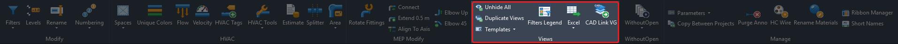</p>

<table>
<tr><th></th><th align="left">Narzędzie</th><th align="left">W skrócie</th></tr>
<tr><td></td><td><a href="#unhide-all">Unhide All</a></td><td>Odkrywa jednym kliknięciem wszystkie elementy ukryte w aktywnym widoku.</td></tr>
<tr><td></td><td><a href="#duplicate-views">Duplicate Views</a></td><td>Duplikuje wiele widoków naraz, w wybranej liczbie kopii i trybie duplikacji.</td></tr>
<tr><td></td><td colspan="2"><b>▾ Templates</b> <sub>– Lista rozwijana z transferem szablonów widoków i zestawień między otwartymi projektami.</sub></td></tr>
<tr><td></td><td>&nbsp;&nbsp;&nbsp;&nbsp;<a href="#view-templates">View Templates</a></td><td>Kopiuje wybrane szablony widoków (view templates) między otwartymi projektami.</td></tr>
<tr><td></td><td>&nbsp;&nbsp;&nbsp;&nbsp;<a href="#schedule-templates">Schedule Templates</a></td><td>Kopiuje wybrane szablony zestawień między otwartymi projektami.</td></tr>
<tr><td></td><td><a href="#filters-legend">Filters Legend</a></td><td>Tworzy widok legendy z próbkami grafiki i opisami filtrów przypisanych do wybranych widoków i szablonów.</td></tr>
<tr><td></td><td><a href="#cad-link-vg">CAD Link VG</a></td><td>Kopiuje ustawienia widoczności i nadpisania warstw z jednego linku CAD do drugiego.</td></tr>
</table>

<br>

<a id="unhide-all"></a>

###  Unhide All

  

<table>
<tr>
<td width="440" align="center" valign="top">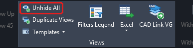</td>
<td valign="top">

**Co robi**<br>Odkrywa jednym kliknięciem wszystkie elementy ukryte w aktywnym widoku.

**Jak użyć**

1. Uruchom polecenie w bieżącym widoku.

**Zakres**<br>Tylko elementy ukryte poleceniem *Hide in View* w aktywnym widoku.

</td>
</tr>
</table>

<p align="right"><sub><a href="#narzedzia">↑ do spisu narzędzi</a></sub></p>

<br>

<a id="duplicate-views"></a>

###  Duplicate Views

 

<table>
<tr>
<td width="440" align="center" valign="top">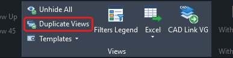</td>
<td valign="top">

**Co robi**<br>Duplikuje wiele widoków naraz, w wybranej liczbie kopii i trybie duplikacji.

**Jak użyć**

1. Wybierz widoki.
2. Ustaw liczbę kopii i tryb: Duplicate, WithDetailing albo AsDependent.
3. Zatwierdź.

**Zakres**<br>Tworzy serie kopii wybranych widoków.

</td>
</tr>
</table>

<p align="right"><sub><a href="#narzedzia">↑ do spisu narzędzi</a></sub></p>

<br>

<a id="view-templates"></a>

###  View Templates

  

<table>
<tr>
<td width="440" align="center" valign="top">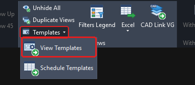</td>
<td valign="top">

**Co robi**<br>Kopiuje wybrane szablony widoków (view templates) między otwartymi projektami.

**Jak użyć**

1. Otwórz projekt źródłowy i docelowy.
2. Wybierz view templates do skopiowania.
3. Zdecyduj o nadpisaniu istniejących pozycji.

**Zakres**<br>Synchronizacja standardu widoków, bez szablonów zestawień.

</td>
</tr>
</table>

<p align="right"><sub><a href="#narzedzia">↑ do spisu narzędzi</a></sub></p>

<br>

<a id="schedule-templates"></a>

###  Schedule Templates

  

<table>
<tr>
<td width="440" align="center" valign="top">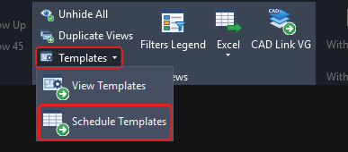</td>
<td valign="top">

**Co robi**<br>Kopiuje wybrane szablony zestawień między otwartymi projektami.

**Jak użyć**

1. Otwórz projekt źródłowy i docelowy.
2. Wybierz szablony zestawień do skopiowania.
3. Zdecyduj o nadpisaniu istniejących pozycji.

**Zakres**<br>Synchronizacja standardu zestawień między modelami.

</td>
</tr>
</table>

<p align="right"><sub><a href="#narzedzia">↑ do spisu narzędzi</a></sub></p>

<br>

<a id="filters-legend"></a>

###  Filters Legend

 

<table>
<tr>
<td width="440" align="center" valign="top">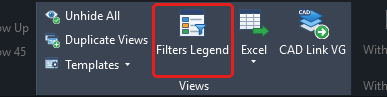</td>
<td valign="top">

**Co robi**<br>Tworzy widok legendy z próbkami grafiki i opisami filtrów przypisanych do wybranych widoków i szablonów.

**Jak użyć**

1. Wybierz widoki albo view templates.
2. Uruchom polecenie.
3. Narzędzie utworzy nową legendę.

**Zakres**<br>Generuje nowy widok legendy.

</td>
</tr>
</table>

<p align="right"><sub><a href="#narzedzia">↑ do spisu narzędzi</a></sub></p>

<br>

<a id="cad-link-vg"></a>

###  CAD Link VG

  

<table>
<tr>
<td width="440" align="center" valign="top">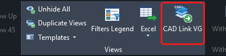</td>
<td valign="top">

**Co robi**<br>Kopiuje ustawienia widoczności i nadpisania warstw z jednego linku CAD do drugiego.

**Jak użyć**

1. Uruchom narzędzie w aktywnym widoku.
2. Wybierz link źródłowy i docelowy.
3. Zatwierdź kopiowanie.

**Zakres**<br>Aktywny widok. Warstwy są dopasowywane po nazwach subkategorii.

</td>
</tr>
</table>

<p align="right"><sub><a href="#narzedzia">↑ do spisu narzędzi</a></sub></p>

<br>

<br>

---

<br>

<a id="panel-withoutopen"></a>

## 📦 Panel WithoutOpen


> Operacje wsadowe na plikach .rvt / .rfa bez otwierania ich w interfejsie Revita.

<p align="center">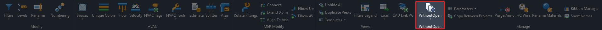</p>

<table>
<tr><th></th><th align="left">Narzędzie</th><th align="left">W skrócie</th></tr>
<tr><td></td><td colspan="2"><b>▾ WithoutOpen</b> <sub>– Lista rozwijana z narzędziami wsadowymi. Pliki są otwierane w tle albo wcale, bez pokazywania w UI.</sub></td></tr>
<tr><td></td><td>&nbsp;&nbsp;&nbsp;&nbsp;<a href="#scan-files">Scan Files</a></td><td>Skanuje pliki .rvt i .rfa bez otwierania ich w UI i tworzy raport: wersja Revita, typ pliku, worksharing i przydatność do operacji wsadowych.</td></tr>
<tr><td></td><td>&nbsp;&nbsp;&nbsp;&nbsp;<a href="#unload-links">Unload Links</a></td><td>Ustawia linki zewnętrzne lokalnych projektów jako niezaładowane przy następnym otwarciu, bez otwierania modelu.</td></tr>
<tr><td></td><td>&nbsp;&nbsp;&nbsp;&nbsp;<a href="#family-report">Family Report</a></td><td>Odczytuje parametry wybranych rodzin .rfa, otwierając je w tle, i tworzy raport CSV.</td></tr>
<tr><td></td><td>&nbsp;&nbsp;&nbsp;&nbsp;<a href="#viewer-export">Viewer Export</a></td><td>Zapisuje wybrane modele ACC razem z ich linkami RVT do lokalnego folderu, gotowe do Autodesk Viewer.</td></tr>
<tr><td></td><td>&nbsp;&nbsp;&nbsp;&nbsp;<a href="#upgrade-copy">Upgrade Copy</a></td><td>Aktualizuje pliki .rvt i .rfa do wersji uruchomionego Revita i zapisuje kopie we wskazanym folderze.</td></tr>
<tr><td></td><td>&nbsp;&nbsp;&nbsp;&nbsp;<a href="#add-shared">Add Shared</a></td><td>Dodaje wybrane shared parameters z pliku do wielu rodzin .rfa naraz.</td></tr>
<tr><td></td><td>&nbsp;&nbsp;&nbsp;&nbsp;<a href="#rename-family-params">Rename Family Params</a></td><td>Zmienia nazwy edytowalnych parametrów rodzinnych w wielu plikach .rfa według wspólnych reguł.</td></tr>
</table>

<br>

<a id="scan-files"></a>

###  Scan Files

   

<table>
<tr>
<td width="440" align="center" valign="top">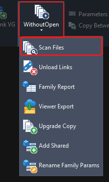</td>
<td valign="top">

**Co robi**<br>Skanuje pliki .rvt i .rfa bez otwierania ich w UI i tworzy raport: wersja Revita, typ pliku, worksharing i przydatność do operacji wsadowych.

**Jak użyć**

1. Wybierz pliki albo folder.
2. Uruchom skanowanie.
3. Sprawdź raport.

**Zakres**<br>Dowolne pliki .rvt / .rfa. Działa także bez otwartego projektu.

</td>
</tr>
</table>

<p align="right"><sub><a href="#narzedzia">↑ do spisu narzędzi</a></sub></p>

<br>

<a id="unload-links"></a>

###  Unload Links

  

<table>
<tr>
<td width="440" align="center" valign="top">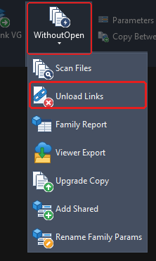</td>
<td valign="top">

**Co robi**<br>Ustawia linki zewnętrzne lokalnych projektów jako niezaładowane przy następnym otwarciu, bez otwierania modelu.

**Jak użyć**

1. Wybierz lokalne pliki .rvt.
2. Uruchom polecenie.
3. Zapisz wynik.

**Zakres**<br>Wykorzystuje TransmissionData, projekt nie jest otwierany w UI.

</td>
</tr>
</table>

> [!TIP]
> Przydaje się, gdy ciężkie linki spowalniają otwieranie modelu.

<p align="right"><sub><a href="#narzedzia">↑ do spisu narzędzi</a></sub></p>

<br>

<a id="family-report"></a>

###  Family Report

   

<table>
<tr>
<td width="440" align="center" valign="top">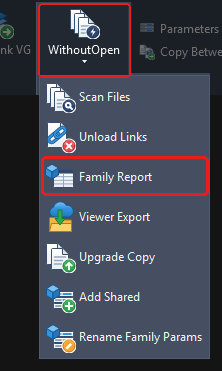</td>
<td valign="top">

**Co robi**<br>Odczytuje parametry wybranych rodzin .rfa, otwierając je w tle, i tworzy raport CSV.

**Jak użyć**

1. Wybierz rodziny.
2. Uruchom raport.
3. Odbierz plik CSV.

**Zakres**<br>Szybka analiza wielu rodzin bez ręcznego otwierania każdej z nich.

</td>
</tr>
</table>

<p align="right"><sub><a href="#narzedzia">↑ do spisu narzędzi</a></sub></p>

<br>

<a id="viewer-export"></a>

###  Viewer Export

   

<table>
<tr>
<td width="440" align="center" valign="top">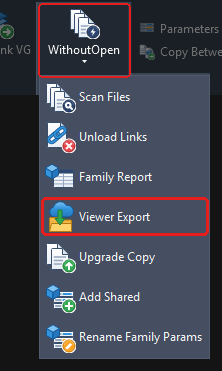</td>
<td valign="top">

**Co robi**<br>Zapisuje wybrane modele ACC razem z ich linkami RVT do lokalnego folderu, gotowe do Autodesk Viewer. Otwiera w trybie detach, robi Purge Unused w pętli i przepina linki na lokalne kopie.

**Jak użyć**

1. Wybierz modele główne z listy (cache Revita).
2. Wskaż folder docelowy, np. OneDrive.
3. Sprawdź raport.

**Zakres**<br>Modele ACC otwierane wcześniej w tej wersji Revita. Niczego nie zapisuje do ACC.

</td>
</tr>
</table>

> [!WARNING]
> Istniejące pliki w folderze docelowym są nadpisywane.

<p align="right"><sub><a href="#narzedzia">↑ do spisu narzędzi</a></sub></p>

<br>

<a id="upgrade-copy"></a>

###  Upgrade Copy

  

<table>
<tr>
<td width="440" align="center" valign="top"></td>
<td valign="top">

**Co robi**<br>Aktualizuje pliki .rvt i .rfa do wersji uruchomionego Revita i zapisuje kopie we wskazanym folderze.

**Jak użyć**

1. Wybierz pliki i folder docelowy.
2. Uruchom upgrade.
3. Sprawdź wynik.

**Zakres**<br>Starsze pliki są aktualizowane, a pliki już aktualne tylko kopiowane. Oryginały zostają nietknięte.

</td>
</tr>
</table>

<p align="right"><sub><a href="#narzedzia">↑ do spisu narzędzi</a></sub></p>

<br>

<a id="add-shared"></a>

###  Add Shared

   

<table>
<tr>
<td width="440" align="center" valign="top"></td>
<td valign="top">

**Co robi**<br>Dodaje wybrane shared parameters z pliku do wielu rodzin .rfa naraz. Rodziny są otwierane w tle.

**Jak użyć**

1. Wybierz plik Shared Parameters i rodziny.
2. Zaznacz definicje, ustaw Instance albo Type i grupę.
3. Zapisz zmiany.

**Zakres**<br>Wsadowo, bez otwierania rodzin w UI.

</td>
</tr>
</table>

<p align="right"><sub><a href="#narzedzia">↑ do spisu narzędzi</a></sub></p>

<br>

<a id="rename-family-params"></a>

###  Rename Family Params

  

<table>
<tr>
<td width="440" align="center" valign="top"></td>
<td valign="top">

**Co robi**<br>Zmienia nazwy edytowalnych parametrów rodzinnych w wielu plikach .rfa według wspólnych reguł.

**Jak użyć**

1. Wybierz rodziny .rfa.
2. Ustaw reguły zmiany nazw.
3. Zapisz wynik.

**Zakres**<br>Działa w tle. Pomija parametry shared, systemowe i kolizje nazw.

</td>
</tr>
</table>

<p align="right"><sub><a href="#narzedzia">↑ do spisu narzędzi</a></sub></p>

<br>

<br>

---

<br>

<a id="panel-manage"></a>

## ⚙️ Panel Manage


> Parametry projektu, kopiowanie między projektami, porządki i zarządzanie wstążką.

<p align="center"></p>

<table>
<tr><th></th><th align="left">Narzędzie</th><th align="left">W skrócie</th></tr>
<tr><td></td><td colspan="2"><b>▾ Parameters</b> <sub>– Lista rozwijana z narzędziami do sprawdzania, uzupełniania i przeliczania parametrów.</sub></td></tr>
<tr><td></td><td>&nbsp;&nbsp;&nbsp;&nbsp;<a href="#shared-params">Shared Params</a></td><td>Sprawdza, czy w projekcie są wymagane parametry współdzielone <code>HC_*</code>, i dodaje brakujące do odpowiednich kategorii.</td></tr>
<tr><td></td><td>&nbsp;&nbsp;&nbsp;&nbsp;<a href="#param-audit">Param Audit</a></td><td>Diagnozuje konfliktowe parametry projektu BimObject (<code>Nominal width</code>, <code>Nominal height</code>, <code>Weight Net (Kg)</code>): typ danych, GUID, bindingi, kategorie, wartości, zestawienia i filtry.</td></tr>
<tr><td></td><td>&nbsp;&nbsp;&nbsp;&nbsp;<a href="#param-service">Param Service</a></td><td>Importuje predefiniowane parametry z Autodesk Parameter Service.</td></tr>
<tr><td></td><td>&nbsp;&nbsp;&nbsp;&nbsp;<a href="#calculator">Calculator</a></td><td>Wykonuje działania matematyczne na co najmniej dwóch parametrach liczbowych (Double / Integer) i zapisuje wynik do wybranego parametru.</td></tr>
<tr><td></td><td>&nbsp;&nbsp;&nbsp;&nbsp;<a href="#clear-param">Clear Param</a></td><td>Czyści wartości wybranego parametru tekstowego.</td></tr>
<tr><td></td><td>&nbsp;&nbsp;&nbsp;&nbsp;<a href="#copy-param">Copy Param</a></td><td>Kopiuje wartość z jednego parametru do drugiego na elementach instalacji.</td></tr>
<tr><td></td><td><a href="#copy-between-projects">Copy Between Projects</a></td><td>Kopiuje Level Type, Grid Type, Family i Family Type między otwartymi projektami.</td></tr>
<tr><td></td><td><a href="#purge-anno">Purge Anno</a></td><td>Wyszukuje i usuwa nieużywane style adnotacji.</td></tr>
<tr><td></td><td><a href="#hc-wire">HC Wire</a></td><td>Generuje skrócony opis przewodu dla obwodów elektrycznych typu Power w formacie <code>liczba żył x przekrój mm2</code>.</td></tr>
<tr><td></td><td><a href="#rename-materials">Rename Materials</a></td><td>Seryjnie zmienia nazwy materiałów: prefiks, zamiana tekstu i sufiks, z podglądem.</td></tr>
<tr><td></td><td><a href="#ribbon-manager">Ribbon Manager</a></td><td>Porządkuje wstążkę Revita: ukrywa, łączy, przenosi i przemianowuje karty oraz panele, także innych wtyczek.</td></tr>
<tr><td></td><td><a href="#short-names">Short Names</a></td><td>Jednym kliknięciem skraca nazwy wszystkich kart i paneli, także natywnych (np. <i>Architecture</i> na <i>Arch</i>, <i>Work Plane</i> na <i>WPlane</i>).</td></tr>
</table>

<br>

<a id="shared-params"></a>

###  Shared Params

  

<table>
<tr>
<td width="440" align="center" valign="top"></td>
<td valign="top">

**Co robi**<br>Sprawdza, czy w projekcie są wymagane parametry współdzielone `HC_*`, i dodaje brakujące do odpowiednich kategorii.

**Jak użyć**

1. Ustaw poprawny plik Shared Parameters.
2. Uruchom polecenie.
3. Zapisz wynik.

**Zakres**<br>Odpowiednie kategorie projektu.

</td>
</tr>
</table>

<p align="right"><sub><a href="#narzedzia">↑ do spisu narzędzi</a></sub></p>

<br>

<a id="param-audit"></a>

###  Param Audit

  

<table>
<tr>
<td width="440" align="center" valign="top"></td>
<td valign="top">

**Co robi**<br>Diagnozuje konfliktowe parametry projektu BimObject (`Nominal width`, `Nominal height`, `Weight Net (Kg)`): typ danych, GUID, bindingi, kategorie, wartości, zestawienia i filtry.

**Jak użyć**

1. Uruchom w projekcie.
2. Przefiltruj raport.
3. Wyeksportuj CSV przed decyzją o usunięciu albo migracji.

**Zakres**<br>Parametry projektu i ich użycie w modelu.

</td>
</tr>
</table>

<p align="right"><sub><a href="#narzedzia">↑ do spisu narzędzi</a></sub></p>

<br>

<a id="param-service"></a>

###  Param Service

   

<table>
<tr>
<td width="440" align="center" valign="top"></td>
<td valign="top">

**Co robi**<br>Importuje predefiniowane parametry z Autodesk Parameter Service. Brakujące parametry dodaje z domyślnymi kategoriami, bindingiem Instance/Type i grupą.

**Jak użyć**

1. Uzupełnij listę identyfikatorów parametrów w kodzie.
2. Uruchom polecenie.
3. Brakujące parametry zostaną dodane automatycznie.

**Zakres**<br>Dokument projektu. Wymaga zalogowania do Autodesk i dostępu do parametrów.

</td>
</tr>
</table>

> [!IMPORTANT]
> Dostępne tylko w Revit 2026 i nowszych.

<p align="right"><sub><a href="#narzedzia">↑ do spisu narzędzi</a></sub></p>

<br>

<a id="calculator"></a>

###  Calculator

 

<table>
<tr>
<td width="440" align="center" valign="top"></td>
<td valign="top">

**Co robi**<br>Wykonuje działania matematyczne na co najmniej dwóch parametrach liczbowych (Double / Integer) i zapisuje wynik do wybranego parametru.

**Jak użyć**

1. Opcjonalnie zaznacz elementy.
2. Wybierz parametry źródłowe, operator i parametr docelowy.
3. Ustaw liczbę miejsc po przecinku i uruchom obliczenie.

**Zakres**<br>Zaznaczenie, a bez zaznaczenia cały model. Elementy bez wszystkich wybranych parametrów są pomijane.

</td>
</tr>
</table>

<p align="right"><sub><a href="#narzedzia">↑ do spisu narzędzi</a></sub></p>

<br>

<a id="clear-param"></a>

###  Clear Param

 

<table>
<tr>
<td width="440" align="center" valign="top"></td>
<td valign="top">

**Co robi**<br>Czyści wartości wybranego parametru tekstowego.

**Jak użyć**

1. Opcjonalnie zaznacz elementy.
2. Wybierz zakres, parametr i ewentualnie kategorię.
3. Potwierdź wyczyszczenie.

**Zakres**<br>Zaznaczenie, wybrana kategoria albo cały model, dla elementów z tym parametrem.

</td>
</tr>
</table>

<p align="right"><sub><a href="#narzedzia">↑ do spisu narzędzi</a></sub></p>

<br>

<a id="copy-param"></a>

###  Copy Param

  

<table>
<tr>
<td width="440" align="center" valign="top"></td>
<td valign="top">

**Co robi**<br>Kopiuje wartość z jednego parametru do drugiego na elementach instalacji.

**Jak użyć**

1. Opcjonalnie zaznacz elementy instalacji.
2. Wybierz zakres, parametr źródłowy i docelowy.
3. Potwierdź nadpisanie.

**Zakres**<br>Zaznaczenie albo wszystkie obsługiwane elementy instalacji. Lista docelowa pokazuje tylko parametry o zgodnym typie danych.

</td>
</tr>
</table>

<p align="right"><sub><a href="#narzedzia">↑ do spisu narzędzi</a></sub></p>

<br>

<a id="copy-between-projects"></a>

###  Copy Between Projects

 

<table>
<tr>
<td width="440" align="center" valign="top"></td>
<td valign="top">

**Co robi**<br>Kopiuje Level Type, Grid Type, Family i Family Type między otwartymi projektami.

**Jak użyć**

1. Wybierz projekt źródłowy i docelowy.
2. Przefiltruj listę i zaznacz pozycje.
3. Uruchom kopiowanie.

**Zakres**<br>Wymaga co najmniej dwóch otwartych projektów. Przy konflikcie nazw zostają typy z projektu docelowego.

</td>
</tr>
</table>

<p align="right"><sub><a href="#narzedzia">↑ do spisu narzędzi</a></sub></p>

<br>

<a id="purge-anno"></a>

###  Purge Anno

 

<table>
<tr>
<td width="440" align="center" valign="top"></td>
<td valign="top">

**Co robi**<br>Wyszukuje i usuwa nieużywane style adnotacji.

**Jak użyć**

1. Uruchom narzędzie.
2. Sprawdź listę nieużywanych stylów.
3. Zatwierdź usunięcie.

**Zakres**<br>Typy kategorii Annotation bez instancji w modelu.

</td>
</tr>
</table>

<p align="right"><sub><a href="#narzedzia">↑ do spisu narzędzi</a></sub></p>

<br>

<a id="hc-wire"></a>

###  HC Wire

  

<table>
<tr>
<td width="440" align="center" valign="top"></td>
<td valign="top">

**Co robi**<br>Generuje skrócony opis przewodu dla obwodów elektrycznych typu Power w formacie `liczba żył x przekrój mm2`.

**Jak użyć**

1. Uruchom polecenie w projekcie z obwodami.

**Zakres**<br>Nadpisuje `HC_WireSize` na podstawie liczby żył i przekroju z Wire Size.

</td>
</tr>
</table>

<p align="right"><sub><a href="#narzedzia">↑ do spisu narzędzi</a></sub></p>

<br>

<a id="rename-materials"></a>

###  Rename Materials

 

<table>
<tr>
<td width="440" align="center" valign="top"></td>
<td valign="top">

**Co robi**<br>Seryjnie zmienia nazwy materiałów: prefiks, zamiana tekstu i sufiks, z podglądem.

**Jak użyć**

1. Wybierz materiały.
2. Ustaw prefiks, zamianę tekstu i/lub sufiks.
3. Sprawdź podgląd i zatwierdź.

**Zakres**<br>Tylko wybrane materiały.

</td>
</tr>
</table>

<p align="right"><sub><a href="#narzedzia">↑ do spisu narzędzi</a></sub></p>

<br>

<a id="ribbon-manager"></a>

###  Ribbon Manager

  

<table>
<tr>
<td width="440" align="center" valign="top"></td>
<td valign="top">

**Co robi**<br>Porządkuje wstążkę Revita: ukrywa, łączy, przenosi i przemianowuje karty oraz panele, także innych wtyczek.

**Jak użyć**

1. Zaznacz kartę i odznacz niepotrzebne karty lub panele.
2. Utwórz własną kartę i przenieś do niej panele wtyczek albo połącz karty.
3. Zmień nazwy i zapisz.

**Zakres**<br>Panele natywne można ukrywać i przemianowywać, panele wtyczek także przenosić.

</td>
</tr>
</table>

> [!TIP]
> Układ zapisuje się w `%AppData%\HCB\RibbonLayout.json` i można go wyeksportować dla zespołu.

<p align="right"><sub><a href="#narzedzia">↑ do spisu narzędzi</a></sub></p>

<br>

<a id="short-names"></a>

###  Short Names

  

<table>
<tr>
<td width="440" align="center" valign="top"></td>
<td valign="top">

**Co robi**<br>Jednym kliknięciem skraca nazwy wszystkich kart i paneli, także natywnych (np. *Architecture* na *Arch*, *Work Plane* na *WPlane*). Na wstążce mieści się wtedy więcej kart.

**Jak użyć**

1. Kliknij, aby skrócić.
2. Kliknij ponownie, aby przywrócić.

**Zakres**<br>Wszystkie karty i panele. Własne nazwy z Ribbon Manager mają pierwszeństwo.

</td>
</tr>
</table>

> [!NOTE]
> Ustawienie jest zapamiętywane. Osobno dla kart i paneli włączysz je w Ribbon Manager.

<p align="right"><sub><a href="#narzedzia">↑ do spisu narzędzi</a></sub></p>

<br>

<br>

---

<br>

<!-- TOOLS:END -->

<a id="dla-deweloperow"></a>

## 🛠️ Dla deweloperów

### Struktura repozytorium

| Ścieżka | Zawartość |
| --- | --- |
| `src/HCB.RevitAddin/` | Wtyczka. `net8.0-windows` dla R25/R26, `net10.0-windows` dla R27. Każde narzędzie w osobnym folderze `Features/<Nazwa>/` |
| `src/HCB.RevitAddin/Infrastructure/RibbonDefinitions.cs` | Układ wstążki: panele, listy rozwijane, przyciski i podpowiedzi |
| `src/HCB.RevitInstaller/` | Instalator MSI (WiX), per-user, dla Revit 2025, 2026 i 2027 |
| `kodyfikacja/` | Dane projektowe dołączane do wtyczki (`Systemy HCB.csv`) |
| `tools/icons/` | Ikony wstążki: źródła SVG i generator PNG |
| `tools/docs/` | Generator tej strony i zrzutów wstążki |
| `docs/` | Dokumentacja techniczna |

### Build

```powershell
dotnet build .\Revit_Codex_HCB.sln -c "Debug R25" -p:DeployOnBuild=false -p:DeployRevitAddin=false
```

Konfiguracje: `Debug R25` / `R26` / `R27` oraz `Release R25` / `R26` / `R27`. Build `R27` wymaga .NET 10 SDK, `R25` i `R26` .NET 8 SDK.

> [!IMPORTANT]
> `DeployOnBuild` jest domyślnie włączone, więc zwykły build kopiuje wtyczkę do `%AppData%\Autodesk\Revit\Addins\<rok>\` i nadpisuje zainstalowaną wersję. Do samej kompilacji dodawaj `-p:DeployOnBuild=false -p:DeployRevitAddin=false`, jak wyżej.

### Wdrożenie do lokalnego Revita

```powershell
dotnet build .\Revit_Codex_HCB.sln -c "Debug R25 Deploy"   # albo R26 / R27
```

Revit danej wersji musi być zamknięty, bo blokuje `HCB.RevitAddin.dll`. Pełna procedura, także dla agentów AI: [docs/DeployToRevit.md](docs/DeployToRevit.md).

### Instalator MSI

```powershell
dotnet build .\src\HCB.RevitInstaller\HCB.RevitInstaller.wixproj -c "Release R25"   # albo R26 / R27
```

Wynik: `src/HCB.RevitInstaller/bin/Release <R2x>/HCB.RevitInstaller.msi`. Wersję produktu (obecnie `1.0.3`) ustawia `InstallerProductVersion` w `HCB.RevitInstaller.wixproj`. Procedura wydania: [docs/Installer.md](docs/Installer.md).

### Ta strona

Sekcje hero i **Narzędzia** są generowane z definicji wstążki. Po dodaniu narzędzia uzupełnij `tools/docs/tool_texts.py` i uruchom `python tools/docs/build_readme.py`. Szczegóły i zrzuty ekranu: [docs/ToolsDocumentation.md](docs/ToolsDocumentation.md).

<br>

<a id="dokumentacja"></a>

## 📚 Dokumentacja

| Dokument | O czym |
| --- | --- |
| [GitHubSolutionOverview.md](docs/GitHubSolutionOverview.md) | Opis rozwiązania |
| [DeployToRevit.md](docs/DeployToRevit.md) | Wdrożenie do lokalnego Revita (deweloperzy i agenci AI) |
| [Installer.md](docs/Installer.md) | Budowa MSI, wersjonowanie, wydanie |
| [UiGuidelines.md](docs/UiGuidelines.md) | Zasady okien i UI |
| [IconWorkflow.md](docs/IconWorkflow.md) | Ikony wstążki |
| [ToolsDocumentation.md](docs/ToolsDocumentation.md) | Generowanie tej strony i zrzutów |
| [WithoutOpenPlan.md](docs/WithoutOpenPlan.md) | Operacje wsadowe bez otwierania plików |
| [PortingPlan.md](docs/PortingPlan.md) | Plan przenoszenia narzędzi z `HCB_Tools` |
